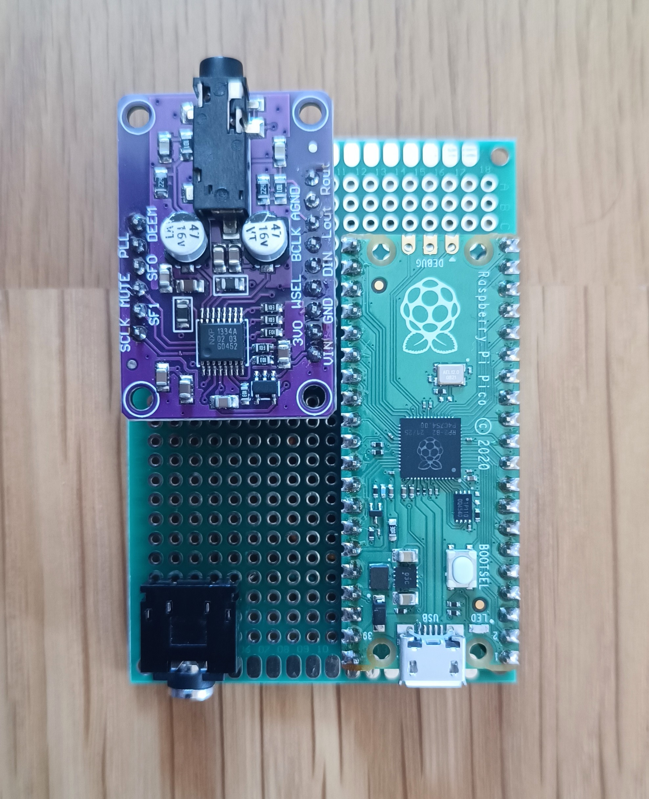

# Pocket DAC and USBMIDI to Clock

Pocket DAC and USBMIDI to Clock is a Raspberry Pi Pico-based audio and clock bridge for retro handheld music setups.

The project was inspired by drum machines and grooveboxes used on retro handhelds, including M8Tracker and music tools distributed through PortMaster. Connect a compatible handheld over USB to send its audio to an external I2S DAC and convert incoming MIDI Clock into 5 V clock pulses for analog gear. The handheld software must support USB audio and MIDI output; this Pico is a USB device, not a USB host.

<p align="center">
	
</p>

## Features

- USB Audio Class 2.0 playback: stereo, 24-bit PCM at 48 kHz
- Asynchronous USB audio feedback synchronized to the actual I2S output clock
- PIO-driven I2S output for a UDA1334A DAC module
- Divides MIDI Clock from 24 PPQN to 4 PPQN: four 20 ms, 5 V clock pulses per beat

For example, a 120 BPM MIDI Clock produces 480 output pulses per minute. After an external divide-by-2, the result is 2 PPQN (240 pulses per minute). The input tempo range is up to approximately 560 BPM.

## Wiring

| Raspberry Pi Pico pin | Connection |
| --- | --- |
| GP10 (physical pin 14) | UDA1334A BCLK |
| GP11 (physical pin 15) | UDA1334A DIN |
| GP12 (physical pin 16) | UDA1334A WSEL / LRCLK |
| GP15 (physical pin 20) | 2N3904 base resistor for clock output |
| 3V3(OUT) (physical pin 36) | DAC VIN, if supported by the module |
| GND | Common ground for the DAC and clock circuit |

Do not connect GP15 directly to 5 V equipment. Use the 2N3904 output circuit and protection components. The NPN circuit inverts the signal: GP15 LOW makes the external clock output HIGH.

<p align="center">
	
</p>

## Build

Requirements: Raspberry Pi Pico SDK 1.5.1 or compatible, its TinyUSB submodule, CMake, Ninja, and the ARM GNU toolchain.

```powershell
cmake -S . -B build -G Ninja -DPICO_SDK_PATH="C:/path/to/pico-sdk" -DPICO_BOARD=pico
cmake --build build --target pocket_dac_usb_midi_clock
```

The build creates `build/pocket_dac_usb_midi_clock.uf2`. The root-level `pocket_dac_usb_midi_clock.uf2` is the latest build copied for convenience.

## Flash

Hold BOOTSEL while connecting the Pico over USB. Copy `pocket_dac_usb_midi_clock.uf2` to the mounted `RPI-RP2` drive. The Pico restarts when flashing is complete.

## Notes

- USB VID/PID `0xCAFE:0x4018` is for development only. Use an appropriately assigned VID/PID for distribution.
- USB-A host mode and additional audio effects such as EQ are not implemented.